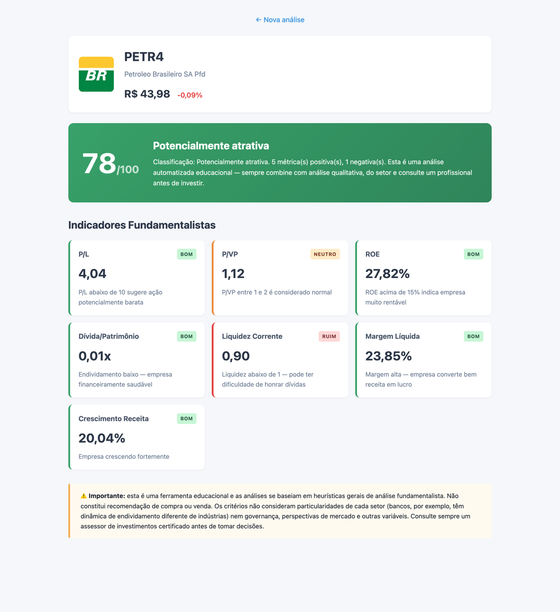
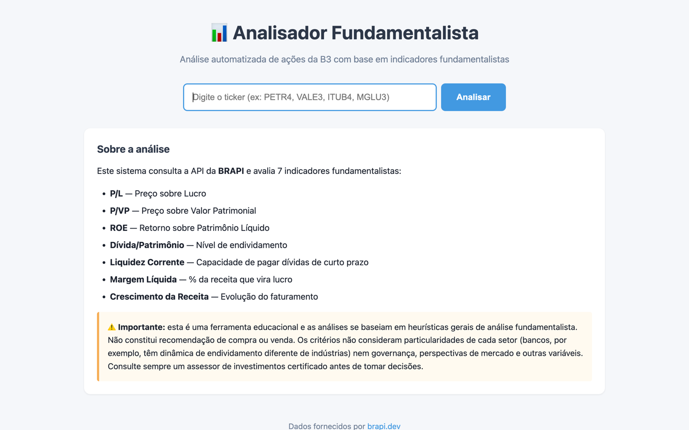

<div align="center">

# 📊 Analisador Fundamentalista de Ações

**Análise automatizada de ações da B3 a partir de 7 indicadores fundamentalistas.**
**Automated fundamental analysis of Brazilian stocks (B3) based on 7 key indicators.**


[](https://github.com/gmhenriquested/analisador-acoes/actions/workflows/ci.yml)

[Português](#-português) · [English](#-english)



</div>

---

## 🇧🇷 Português

### O que faz

Você digita um ticker (ex.: `PETR4`), a aplicação busca os dados na API da
[BRAPI](https://brapi.dev), avalia 7 indicadores e devolve uma nota de 0 a 100 com
a explicação de cada métrica.

| Indicador | Bom | Neutro | Ruim |
|-----------|-----|--------|------|
| P/L (Preço/Lucro) | < 10 | 10 a 20 | > 20 ou negativo |
| P/VP | < 1 | 1 a 2 | > 2 |
| ROE | > 15% | 10% a 15% | < 10% |
| Dívida/Patrimônio | < 0,5x | 0,5x a 1,0x | > 1,0x |
| Liquidez Corrente | > 1,5 | 1,0 a 1,5 | < 1,0 |
| Margem Líquida | > 15% | 5% a 15% | < 5% |
| Crescimento da Receita | > 10% | 0% a 10% | negativo |

Cada métrica vale 2 (bom), 1 (neutro) ou 0 (ruim). A nota final é
`pontos / pontos possíveis × 100`. Métricas sem dado ficam fora da conta.

| Nota | Classificação |
|------|---------------|
| 70 a 100 | Potencialmente atrativa |
| 40 a 69 | Neutra |
| 0 a 39 | Requer cautela |

### Destaques técnicos

- **Arquitetura em camadas**: `controller` → `service` → `client`, com DTOs imutáveis (`record`).
- **Critérios declarativos**: cada indicador é um `CriterioMetrica` com faixas, sem `if` repetido.
- **Tratamento de erros de verdade**: exceções próprias para ticker inexistente, token inválido,
  limite de requisições e BRAPI fora do ar, tratadas num `@ControllerAdvice` com mensagem amigável.
- **Validação de entrada** no formato de ticker da B3 (`PETR4`, `ITUB4F`).
- **Timeout** configurável no `WebClient`.
- **34 testes** (JUnit 5, Mockito, AssertJ) com cobertura via JaCoCo, rodando no GitHub Actions.

### API JSON (para agentes de IA)

Além da interface web, a mesma análise está disponível como API JSON, pensada para ser
consumida por outros programas e por **agentes de IA** (um servidor MCP pode expor esta
análise como ferramenta de agente):

```bash
curl http://localhost:8080/api/analise/PETR4
```

```json
{
  "ticker": "PETR4",
  "nomeEmpresa": "Petróleo Brasileiro S.A. - Petrobras",
  "precoAtual": 38.5,
  "pontuacao": 71,
  "classificacao": "Potencialmente atrativa",
  "metricas": [
    { "nome": "P/L", "valor": "4.20", "status": "BOM", "explicacao": "..." }
  ],
  "resumo": "..."
}
```

Respostas de erro também são JSON: `400` para ticker em formato inválido, `404` para
ticker inexistente e `502` quando a BRAPI está indisponível.

### Servidor MCP (ferramenta de agente)

A aplicação também é um **servidor MCP** (Model Context Protocol, via Spring AI). Um
agente de IA conectado expõe a ferramenta `analisarAcao(ticker)`, que devolve a mesma
análise fundamentalista. O transporte é SSE sobre Spring MVC, no endpoint `/sse`
(com a aplicação rodando, por padrão em `http://localhost:8080/sse`).

Exemplo de configuração num cliente MCP (ex.: Claude Desktop), com a app já no ar:

```json
{
  "mcpServers": {
    "analisador-acoes": {
      "url": "http://localhost:8080/sse"
    }
  }
}
```

Assim o produto é ao mesmo tempo um app web que uma pessoa usa e uma ferramenta que um
agente de IA chama.

### Como rodar

Pré-requisitos: Java 17 e Maven.

```bash
git clone https://github.com/gmhenriquested/analisador-acoes.git
cd analisador-acoes
mvn spring-boot:run
```

Abra http://localhost:8080 e digite um ticker. `PETR4`, `VALE3`, `ITUB4` e `MGLU3`
funcionam sem token. Para outras ações, crie um token grátis em
[brapi.dev](https://brapi.dev/dashboard):

```bash
export BRAPI_TOKEN=seu_token
```

Testes: `mvn test`

### Deploy com Docker

A aplicação tem um `Dockerfile` multi-stage (build com Maven, imagem final só com JRE):

```bash
docker build -t analisador-acoes .
docker run -p 8080:8080 analisador-acoes
# com token para outras ações:
docker run -p 8080:8080 -e BRAPI_TOKEN=seu_token analisador-acoes
```

A imagem lê a porta de `server.port` (8080) e aceita `BRAPI_TOKEN` por variável de
ambiente, o que permite subir em qualquer serviço que rode um container (Render,
Railway, Fly.io, Cloud Run etc.).

### Estrutura

```
src/main/java/br/com/analisador/
├── client/       BrapiClient: chamada HTTP e tradução de erros
├── config/       WebClient com timeout
├── controller/   rotas / e /analisar + GlobalExceptionHandler
├── exception/    exceções de domínio da BRAPI
├── model/        DTOs (records)
└── service/      AnaliseService, CriterioMetrica, Formatador
```

### Próximos passos

- [ ] Cache das consultas (Caffeine)
- [ ] Comparar várias ações lado a lado
- [ ] Critérios por setor (bancos, varejo, indústria)
- [ ] Gráfico de evolução do preço
- [x] API JSON e `Dockerfile` para deploy
- [x] Servidor MCP nativo expondo a análise como ferramenta de agente
- [ ] Deploy público

> ⚠️ Ferramenta educacional. Não é recomendação de investimento. Os critérios não
> consideram as particularidades de cada setor (bancos, por exemplo, têm endividamento
> naturalmente alto).

---

## 🇺🇸 English

### What it does

Type a B3 ticker (e.g. `PETR4`). The app fetches market data from the
[BRAPI](https://brapi.dev) API, scores 7 fundamental indicators (P/E, P/B, ROE,
Debt/Equity, Current Ratio, Net Margin, Revenue Growth) and returns a 0 to 100 score
with a short explanation for each metric.

### Technical highlights

- **Layered architecture** (`controller` → `service` → `client`) with immutable `record` DTOs.
- **Declarative scoring rules**: each indicator is a `CriterioMetrica` with thresholds.
- **Real error handling**: custom exceptions for unknown ticker, invalid token, rate limit
  and API downtime, mapped to friendly messages in a `@ControllerAdvice`.
- **Input validation** against the B3 ticker format.
- **34 tests** (JUnit 5, Mockito, AssertJ) with JaCoCo coverage, running on GitHub Actions.

### Run it

```bash
git clone https://github.com/gmhenriquested/analisador-acoes.git
cd analisador-acoes
mvn spring-boot:run   # then open http://localhost:8080
```

`PETR4`, `VALE3`, `ITUB4` and `MGLU3` work without a token. For other tickers set
`BRAPI_TOKEN` (free at [brapi.dev](https://brapi.dev/dashboard)).

The same analysis is available as a JSON API (`GET /api/analise/PETR4`) and as an
**MCP server** (Spring AI, SSE at `/sse`) exposing an `analisarAcao(ticker)` tool for
AI agents. A multi-stage `Dockerfile` is included for container deploys
(`docker build -t analisador-acoes .`).

> ⚠️ Educational project. Not investment advice.

<div align="center">


Feito por / Made by **[Gabriel Henriques](https://github.com/gmhenriquested)**
</div>
